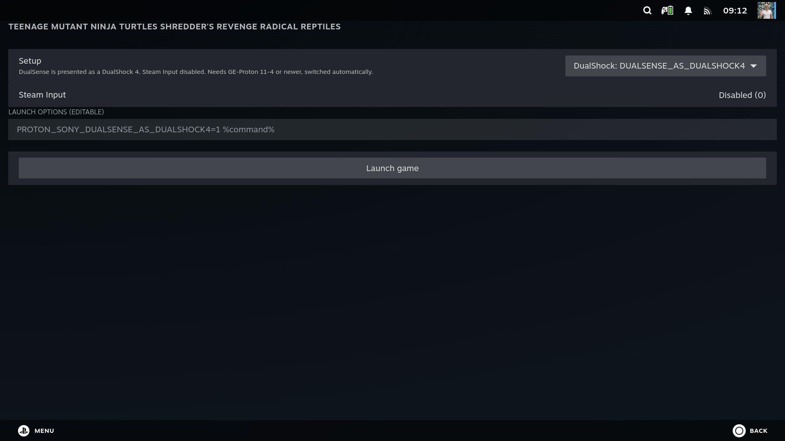

# DualSense Doctor

**English** | [Русский](README.ru.md)

A [Decky Loader](https://decky.xyz/) plugin for the DualSense controller on SteamOS. Two parts in one plugin:

1. **Lab** picks launch options for each game (Proton, `PROTON_*` variables, Steam Input) from a grid of cover art.
2. **Doctor** fixes the Bluetooth connection after sleep when the controller wakes the PC.

Tested with a DualSense and a DualSense Edge over Bluetooth on a SteamOS desktop PC. Other setups may behave differently, reports are welcome (see [Reporting a problem](#reporting-a-problem)).

## Screenshots

| Quick Access menu | Bluetooth settings | Game setup |
| --- | --- | --- |
|  |  |  |

## Lab: launch options per game

Open the Quick Access menu, press "Set up games" and pick a game from the cover grid (7 per row, alphabetical, like Steam's library). Covers come from Steam's local cache and your own artwork in `userdata/*/config/grid` (this is how non-Steam games get covers), then from Steam's servers; a name tile is shown when there is no cover.

For each game you choose one setup: native support, `PROTON_DISABLE_HIDRAW=1`, DualShock 4 emulation and others, or "Steam Input only". The plugin writes the launch options and the Proton version, switches Steam Input on or off for you and starts the game.

Steam Input is enabled only by the "Steam Input only" setup and is off for the others. The plugin always writes an explicit value (2 = on, 0 = off) instead of "default", which depends on global Steam settings. If Steam does not accept the value, the game is not launched. If the launch options were edited by hand and match no setup, Steam Input is left alone.

## Doctor: Bluetooth after sleep

The problem: when the PC wakes up the kernel drops the controller's first packet. The PC then closes the "empty" connection at about 4 seconds, and if the link is kept the controller itself drops it at about 28 seconds. Steam may also open the controller the wrong way (default lightbar color, buttons A and B swapped).

What the plugin does (all of it works without configuration):

- **Early connect:** if the HID channel has not appeared 0.3 seconds after the connection, the plugin opens it itself.
- **Answer to the controller:** sends an L2CAP "pending" response to the lost request 4 times, 15 seconds apart, which stops the 28-second drop.
- **Steam pickup:** the HID device is created right away (the link needs it), but its driver is detached for 2 seconds after the connection (the time is raised automatically if needed, see below), so Steam sees the controller for the first time when it is no longer busy waking up and opens it the right way (one "connected" notification). If Steam still opens it wrongly (the Steam log says "Invalid or missing unit serial number"), the plugin rebinds the driver, up to twice. If this happens twice in a row, the plugin raises the return time by 0.5 s (up to 6 s) on its own and shows a notification; only then a slider for the time appears in the settings, with the default 2 s there is nothing to adjust. The driver is always put back, also when the plugin is unloaded, and the result is checked (retries, then a Bluetooth reconnect request if the link is gone).
- Together with early connect the plugin keeps the Bluetooth adapter from autosuspending (SteamOS turned it on, and with it the controller can wake up half-dead: buttons dead until PS is pressed, wrong lightbar). The original value is put back when early connect is turned off or the plugin is unloaded. There is also an optional HCI trace (btmon) for diagnostics.

How the L2CAP answer finds its parameters: the lost request (its `ident` and source channel id) is read from an HCI trace. btmon is started automatically shortly before the PC goes to sleep (when logind announces it) and stopped about 90 seconds after wake, so there is no constant load. If the trace does not contain the request, the plugin falls back to the values the first request of a fresh connection normally has (`ident=1`, `scid=64`); such a response is marked "guessed" in `events.log` and is not counted as a fix. In every trace recorded during testing the lost request was `ident=1`, PSM 1, source channel 64, so these fallback values match what the controller really sends. This part sends a raw ACL packet through an HCI socket as root, so it is fragile by nature: it was tested with a DualSense and a DualSense Edge, but on one machine only, and other controllers or Bluetooth stacks may need different values.

Known limitation: because of the pickup step the controller becomes usable about 3 seconds after wake, so buttons pressed earlier are ignored.

## Installation

**From a release (needs Decky developer mode):** download `DualSenseDoctor.zip` from the [Releases](https://github.com/MSPortnov/DualSenseDoctor/releases) page, then in Decky enable developer mode and choose "Install plugin from ZIP".

**From source:** needs Node.js 18+ and [pnpm](https://pnpm.io/) 9.

```bash
pnpm install --frozen-lockfile
pnpm run build        # creates dist/
```

Autotests (standard library only, no packages needed): `python3 -m unittest discover -s tests`.

Helper scripts build and install the plugin on a SteamOS machine:

- from a Mac or Linux computer over SSH: `bash deploy.sh ADDRESS` (the address is remembered in `~/.dsd_host`);
- on the SteamOS machine itself: `bash update.sh`.

Both scripts install Node.js (into `~/.local/node`) and pnpm (into `~/.local/pnpm`) if they are missing.

The scripts restart Decky Loader, and Steam reloads its interface when that happens. If the Steam Store opens blank right after an update, open it once more; this is not related to the plugin (it also happens after `sudo systemctl restart plugin_loader`).

## Why the plugin runs as root

`plugin.json` declares the `root` flag. Doctor needs it for things a normal user cannot do:

- writing to `/sys` to detach and re-attach the HID driver (`unbind` / `bind`) and to turn off USB autosuspend of the Bluetooth adapter;
- opening a raw HCI socket to send the L2CAP response;
- running `btmon`: automatically around sleep (for the L2CAP answer) and, if you switch it on, for the HCI trace.

Lab alone would not need it. Nothing is downloaded or sent anywhere, and all changes are listed above.

## Reporting a problem

In the plugin open "Bluetooth settings" and press "Collect Bluetooth report". The report is saved in the home folder of the SteamOS user (`dualsense-doctor-DATE-summary.txt` and a full `.tar.gz` archive). From another computer one command asks the plugin for a fresh report and downloads it (it waits up to 40 seconds; if the plugin does not answer, press the button and run it again):

```bash
bash deploy.sh ADDRESS fetch   # makes a fresh report; report and archive go to ~/Downloads
bash deploy.sh ADDRESS logs    # Decky and plugin logs go to ~/Downloads/dsd-diag.txt
```

Each new report replaces the old ones (and `deploy.sh` removes old reports on the PC when it installs). The last three bytes of every Bluetooth address are replaced with `XX`, but the report still contains system logs, so look through it before posting it publicly. The plugin's own logs are in `~/homebrew/logs/DualSense Doctor/`.

## Settings

Doctor works out of the box. The Bluetooth settings section has switches for each fix (early connect, which also keeps the adapter awake; answer to the controller; Steam pickup with the driver return time; HCI trace) and the optional Action journal. The journal is off by default; while off, session statistics and detailed Bluetooth events stay in memory and are not saved. The latest result remains visible until the plugin restarts. Turning the journal off deletes saved history. A plugin version change clears saved statistics and Bluetooth traces while preserving settings and adapter state. The language (Auto follows Steam, English or Русский) is chosen at the bottom of the panel. It is used for the interface, for the plugin's own log messages (`events.log`, session notes) and for the Bluetooth report, so a report is written in the language you picked. The helper scripts print their messages in the system language.

## License

Copyright (C) 2026 MSPortnov. This program is free software, licensed under the [GNU General Public License v3.0](LICENSE).
